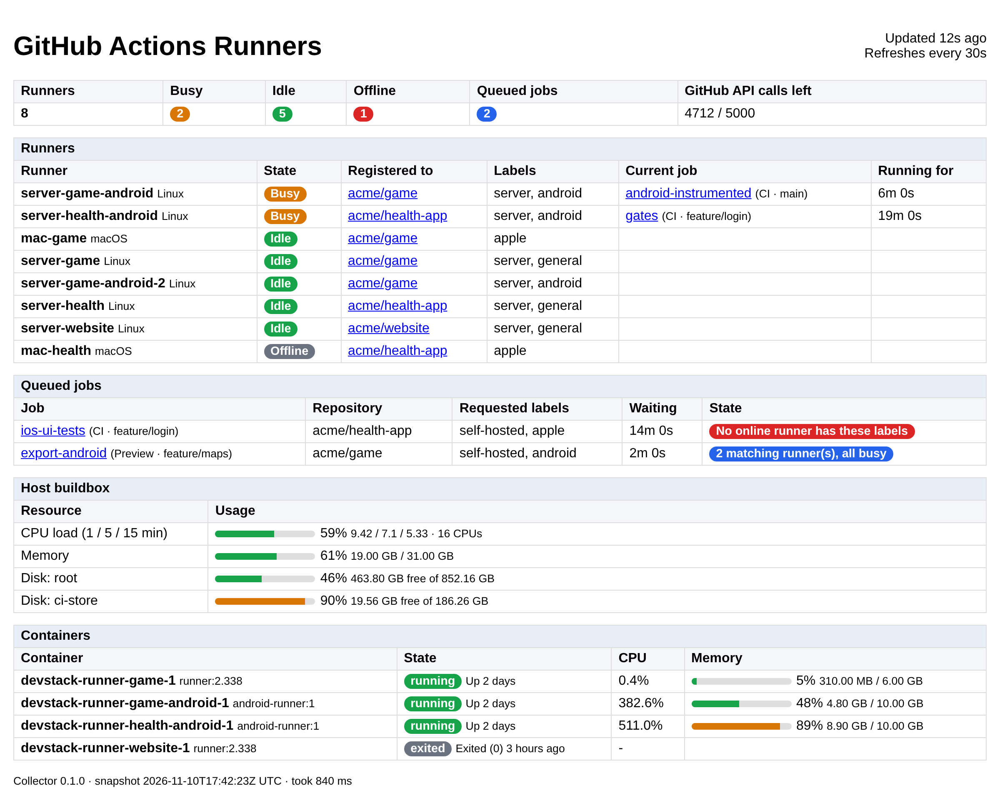

# GitHub Actions Runners for Webmin

A [Webmin](https://webmin.com) module that shows your **self-hosted GitHub Actions runners** on one page: which ones are busy (and with which job), which are idle or offline, which jobs are waiting for a runner, and how loaded the build host is.



## Why

GitHub shows runner status only per repository (Settings → Actions → Runners). That's fine with a single organization runner pool. It gets tedious when you run **repository-level runners for several repositories**, which is the only option for repositories under a personal account. A typical setup is a home server or spare machine running a few runner containers for your private projects.

This module answers the questions you actually have when CI feels slow:

- Which runners are busy right now, with which job, and for how long?
- Which jobs are queued, and why? Is a matching runner simply busy, or does **no online runner have the requested labels** (for example the Mac is asleep)?
- Is the host itself the bottleneck (CPU load, memory, disk, per-container CPU/RAM)?

If you already run Webmin on the build host, this adds the board without another web server, port or login.

## How it works

```
GitHub REST API ──▶ ghrunners-collector ──▶ status.json ──▶ Webmin module (System → GitHub Actions Runners)
Docker API (read-only) ─┘     (token lives here)            (read-only, no secrets)
```

- **`ghrunners-collector`** (Python 3, standard library only) polls the GitHub API every 60 s for the runners and pending jobs of the repositories and organizations you list. It can also read container CPU/RAM from the Docker API and free space of chosen paths. It writes everything to one JSON file.
- **The Webmin module** reads that file and renders it. It never talks to GitHub or Docker and holds no credentials, so Webmin, which runs as root, never sees your token.

The collector uses conditional requests (ETags). Unchanged responses come back as `304 Not Modified`, which [doesn't count against the rate limit](https://docs.github.com/en/rest/using-the-rest-api/best-practices-for-using-the-rest-api#use-conditional-requests-if-appropriate). A poll costs at most 3 requests per repository plus 1 per active workflow run, well inside the 5,000/hour limit for a token.

## Requirements

- Webmin 2.x (tested against the default Authentic theme's UI library; any theme works).
- Python 3.9+ on the host, or Docker, to run the collector.
- A GitHub token with read access to the runners (see below).

## Setup

### 1. Create a read-only GitHub token

Create a **fine-grained personal access token** (GitHub → Settings → Developer settings → Fine-grained tokens):

| Setting | Value |
| --- | --- |
| Resource owner | the user or organization that owns the repositories |
| Repository access | *Only select repositories*: the ones with self-hosted runners |
| Repository permissions | **Administration: Read-only** (needed to list runners), **Actions: Read-only** (queued and running jobs) |
| Organization permissions (only for org runners) | **Self-hosted runners: Read-only** |

A classic token with the `repo` scope also works, but it can do far more than this needs.

### 2. Run the collector

Pick one of the following.

**Docker Compose** (recommended when your runners are containers):

```sh
git clone https://github.com/VSamokhin/webmin-github-runners.git
cd webmin-github-runners/examples
cp collector.env.example .env       # set GHR_REPOS and GHR_GITHUB_TOKEN
chmod 600 .env
sudo install -d -o 10001 -m 755 /var/lib/ghrunners   # the collector runs as uid 10001
docker compose up -d
```

This starts the collector and a [read-only Docker socket proxy](https://github.com/Tecnativa/docker-socket-proxy) that allows listing containers and reading their stats, and nothing else. Keep the proxy on a network that only the collector shares, as the example does: even read-only, the Docker API shows every container's environment variables, so CI jobs or other containers must not be able to reach it. The status file lands in `/var/lib/ghrunners/status.json` on the host. To report free space of more paths, mount them read-only into the collector and add them to `GHR_DISKS`.

**systemd** (no Docker):

```sh
sudo install -m 755 collector/ghrunners_collector.py /usr/local/bin/ghrunners-collector
sudo install -m 600 examples/collector.env.example /etc/ghrunners.env   # then edit it
sudo cp examples/ghrunners-collector.service /etc/systemd/system/
sudo systemctl enable --now ghrunners-collector
```

**One-off or cron**: `ghrunners-collector --once --repos owner/repo --token-file ~/.ghr-token --output /var/lib/ghrunners/status.json`

Check that it works: `cat /var/lib/ghrunners/status.json`, or look at the collector log (`docker compose logs collector`, or `journalctl -u ghrunners-collector`). It logs one line per poll, such as `runners 8 (busy 2, idle 5, offline 1), queued jobs 2`.

### 3. Install the Webmin module

Download `ghrunners.wbm.gz` from the [latest release](https://github.com/VSamokhin/webmin-github-runners/releases/latest), then either:

- in Webmin: **Webmin → Webmin Configuration → Webmin Modules → Install Module**, either *From uploaded file* or *From HTTP or FTP URL* with `https://github.com/VSamokhin/webmin-github-runners/releases/latest/download/ghrunners.wbm.gz`, or
- on the command line: `sudo /usr/share/webmin/install-module.pl ghrunners.wbm.gz`

Refresh the menu (**Refresh Modules**, or reload the page). The module appears as **System → GitHub Actions Runners**. If the collector writes somewhere other than `/var/lib/ghrunners/status.json`, set the path under **Module Config**.

Upgrades are installed the same way and keep your module settings.

## Configuration

### Collector

Settings are environment variables. Every one also has a command-line flag (`ghrunners-collector --help`).

| Variable | Default | Meaning |
| --- | --- | --- |
| `GHR_REPOS` | | `owner/repo` list, comma or space separated |
| `GHR_ORGS` | | organizations whose org-level runners to show |
| `GHR_GITHUB_TOKEN` | | token; `GITHUB_TOKEN` also works |
| `GHR_GITHUB_TOKEN_FILE` | | read the token from a file (Docker/systemd secrets) |
| `GHR_GITHUB_API_URL` | `https://api.github.com` | change for GitHub Enterprise Server |
| `GHR_OUTPUT` | `/var/lib/ghrunners/status.json` | where to write the status file |
| `GHR_INTERVAL` | `60` | seconds between polls (minimum 10) |
| `GHR_DOCKER_HOST` | *(off)* | `unix:///var/run/docker.sock` or `tcp://proxy:2375` |
| `GHR_DOCKER_FILTER` | *(all)* | regex on container names to show, e.g. `runner` |
| `GHR_DISKS` | | `label=path` pairs, e.g. `root=/,ci-cache=/srv/ci-cache` |
| `GHR_PROC` | `/proc` | procfs to read load and memory from (`/host/proc` in Docker) |
| `GHR_LOG_LEVEL` | `INFO` | `DEBUG` to see every request |

### Webmin module (Module Config)

| Option | Default | Meaning |
| --- | --- | --- |
| Status file | `/var/lib/ghrunners/status.json` | the collector's output |
| Warn when older than | 300 s | shows a warning if the collector stopped |
| Auto-refresh | 30 s | `0` disables it |
| Mark queued job as slow after | 900 s | |
| Show GitHub-hosted jobs | No | also list queued jobs for `ubuntu-latest` and similar |

Who can open the page is controlled the usual way, under **Webmin → Webmin Users**.

## What the states mean

- **Busy**: the runner is running a job. The job is shown when it belongs to a watched repository.
- **Idle**: online and waiting for work.
- **Offline**: registered but not connected; the machine or container is down, asleep or lost its registration.
- Queued job **"N matching runner(s), all busy"**: it will start when one frees up.
- Queued job **"No online runner has these labels"**: nothing can take it until a matching runner comes online. Check the labels in `runs-on`.

## Status file format

The JSON written by the collector is a stable interface (`"schema": 1`), so you can feed it to other dashboards too. Top-level keys: `generated_at`, `summary` (counts), `scopes` (one per repository or organization, each with `runners`, `queued` and `running` jobs and an `error`), `containers`, `host` (load, memory, disks), `rate_limit` and `errors`. See [`tests/make_sample.py`](tests/make_sample.py) for a complete example.

## Troubleshooting

| Symptom | Fix |
| --- | --- |
| Installing says "Not a valid Perl module" | That is the **System → Perl Modules** page, which installs CPAN modules. Use **Webmin → Webmin Configuration → Webmin Modules** instead. |
| "status file does not exist" | The collector isn't running, or writes elsewhere. Check its log and the path in Module Config. |
| `HTTP 403 Resource not accessible` for a repository | The token lacks **Administration: Read** on that repository, or the repository isn't selected in the token. |
| `HTTP 401` | Token expired or wrong. |
| A busy runner shows "Job not visible" | It's running a job of a repository you don't watch, or GitHub hasn't reported the job yet. |
| No containers table | `GHR_DOCKER_HOST` is unset, or `GHR_DOCKER_FILTER` matches nothing. |

## Development

```sh
python3 -m unittest discover -s tests   # collector, against fake GitHub and Docker APIs
tests/test_module.sh                     # module syntax and rendering, using a Webmin stub
./build.sh                               # dist/ghrunners.wbm.gz
python3 tests/make_sample.py /tmp/s.json && tests/render.sh /tmp/s.json > /tmp/page.html  # preview
```

### Releases

You choose when to release and which version:

- [Release Drafter](.github/workflows/release-drafter.yml) keeps one draft release for `main`, with the merged pull requests as notes. It proposes the next version from their labels (`major`; `minor` or `feature`; anything else is a patch). Pull requests are labelled from their branch prefix (`feature/`, `bugfix/`, `chore/`) or their Conventional Commits title (`feat:`, `fix:`, `chore:`, ...).
- To release, open the draft under **Releases**, change its tag if you want another version (`vX.Y.Z`), and publish it.
- Publishing runs the [release workflow](.github/workflows/release.yml): it stamps the version into `module.info` and the collector, runs the tests, attaches `ghrunners.wbm.gz` to the release and publishes the collector image to `ghcr.io/vsamokhin/ghrunners-collector` (`X.Y.Z`, `X.Y`, `latest`). **Run workflow** on it rebuilds the latest release, or a tag you name.

The versions in the repository are not bumped by hand; the release tag decides.

## License

[MIT](LICENSE)
